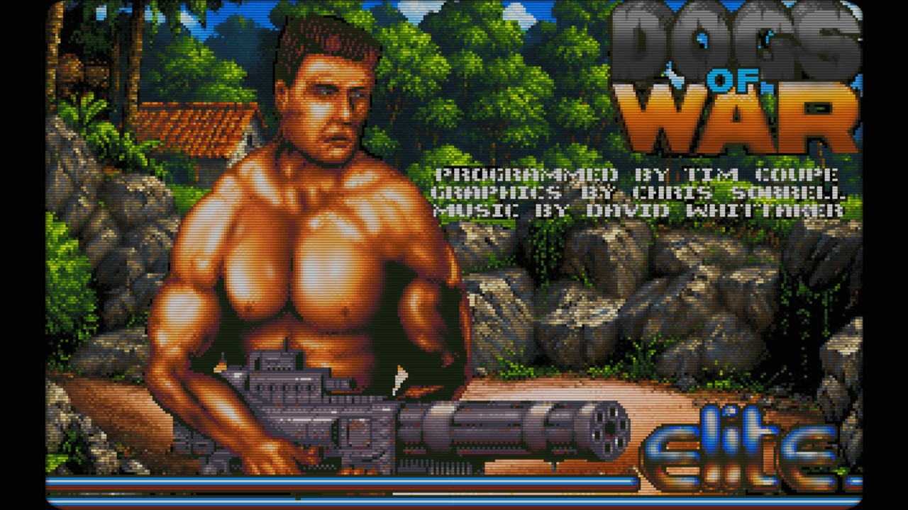

# Dogs of War Atari ST Recomp for Windows

<p align="center">
  <a href="https://www.youtube.com/watch?v=bngajk3MZKU"></a><br>
  <a href="https://www.youtube.com/watch?v=bngajk3MZKU">Gameplay video / Vídeo de gameplay</a>
</p>

> **Where things are** — `source/`: the complete C source (the game translated to C in `source/generated/`, the machine in `source/runtime/`, the Windows program in `source/host/`; build it with `source/build.bat`, see `source/README.md`).
> The ready-to-run program is on the **[Releases](https://github.com/voodatari/Dogs-of-War-Atari-ST-Recomp-for-Windows/releases)** page: a zip with `dowport.exe`, `data/languages/`, `shaders/`, `music/`, `assets/` and `default.json`. The zip already includes the game file `data\FILES\DOW`.

*Versión en español a continuación / Spanish version below: [Dogs of War Atari ST Recomp for Windows – Port para Windows a 60 fps](#dogs-of-war-atari-st-recomp-for-windows--port-para-windows-a-60-fps).*

A native Windows port of **Dogs of War** (Atari ST, Elite 1989, Pera Putnik's HAGA version). The game's own 68000 program, translated to C, runs inside a small
Atari STE machine and is drawn at your monitor's refresh rate: the game logic runs at 25 Hz and the port **interpolates between its frames**, so movement is smooth at 60 Hz
(or 144 Hz…) with very low input latency. It is a single self-contained C program.

## What is this version?
This is **version 1.1.2** (2026-10-20) of an unofficial, fan-made **native Windows port** of *Dogs of War* (Atari ST, Elite Systems 1989, HAGA version by Pera Putnik); every step that led here is in the [changelog](CHANGELOG.md).

**What it is.** The game's own 68000 program has been **translated entirely to C**, and it is compiled, together with a small Atari STE machine (mini-TOS, timers, keyboard and joystick, video, YM2149 sound chip) and a Windows program (OpenGL video, mixer, input, menus), into a single `dowport.exe`. The original game logic runs unchanged at its own 25 Hz; the port draws the images in between, so the movement is smooth at 60 Hz, 144 Hz or whatever your monitor does.

**What it is not.** It is not an emulator of the Atari ST: no 68000 instruction is interpreted, no Atari ROM or TOS is needed, and there is no Python, no cache and no snapshot of the original loader. It does not contain the game's data (graphics, levels, text): you provide the original file `data\FILES\DOW`, which is used only as data, and the graphics dump is generated from it the first time the program starts.

**What it adds to the original**
- Frame interpolation to the refresh rate of your monitor, sub-pixel sprites, and low-latency input and audio.
- Modern video: OpenGL, aspect modes, scaling filters, CRT effects and external shaders.
- Sound: chip synthesis, MP3 music packs with loop points, multichannel effects with stereo panning and volumes per type.
- Replaceable graphics (graphics packs), three save slots and a "back to the mission map" command, redefinable controls with gamepad support, and menus in English and Spanish.
- Corrections of enemy micro-stutters and of explosion glitches that only appear at high frame rates (all can be switched off).

**What stays the same.** The game itself: missions, enemies, weapons, scoring and the timing of the game logic are those of the original.

## Contents
1. [Features](#features) · 2. [Quick start](#quick-start) · 3. [Controls](#controls) · 4. [Options menu](#options-menu) · 5. [Video](#video) · 6. [Sound and music](#sound-and-music)
7. [Motion and latency](#motion-and-latency) · 8. [Graphics packs](#graphics-packs) · 9. [Game fixes](#game-fixes) · 10. [Saving](#saving) · 11. [Files and folders](#files-and-folders)
12. [Configuration reference](#configuration-reference) · 13. [Troubleshooting](#troubleshooting) · 14. [How it works](#how-it-works) · 15. [Building](#building-from-source) · 16. [Changelog](CHANGELOG.md)

## Features
- **60 fps and beyond**: frame interpolation of the 25 Hz game, optional sub-pixel sprite smoothing, and an optional game-speed mode that matches the refresh rate exactly.
- **Low latency**: fast input polling (1000 Hz), low-latency audio output, tunable emulation margin.
- **Video**: OpenGL output with four aspect modes, three scaling filters, built-in CRT effects (scanlines, phosphor mask, curvature, vignette, glow) and external RetroArch `.glsl` shaders.
- **Sound**: YM2149 chip synthesis, a multichannel mixer for the sampled effects, stereo panning of effects by on-screen position, per-type volumes, and replacement **MP3 music packs**.
- **Graphics packs**: every sprite, tile and fixed screen of the game is dumped to editable PNG sheets; a pack of full-colour replacements is drawn instead, with the original animation and interpolation.
- **Controls**: keyboard and XInput gamepads (two players), fully redefinable, plus pad shortcuts for rocket launcher, grenade and hold position, and an optional **twin-stick** mode (left stick moves, right stick aims and fires).
- **Saving**: the original game has no saves; the port adds three slots and a "back to the mission map" command.
- **Fixes** for stutters and glitches that appear only at high frame rates (all can be switched off).

## Quick start
1. The game file `FILES\DOW` must be in the **`data`** folder next to `dowport.exe` (`data\FILES\DOW`); the Release zip already includes it, and if you build from source you copy it there from your original game. It is the only original file needed, and it only provides the game's data; the other files of the disk are not used. If it is missing the program says so and quits.
2. Run `dowport.exe`. On the first start it prepares, in a few seconds, `assets\original\` (the graphics dump, see [Graphics packs](#graphics-packs)).
3. Press **Esc** (or the pad's **Start**) for the options menu.

## Controls
Every key and pad button can be redefined (see below); these are the defaults.

| Action | Keyboard | Gamepad |
|---|---|---|
| Move | Cursor keys | Left stick or D-pad (fixed) |
| Aim and shoot (twin-stick) | – | Right stick, 8 directions: the soldier faces and shoots that way whatever direction he is moving; it also holds fire while pushed (see below) |
| Fire | Ctrl (left or right), Z | A, right trigger |
| Next weapon | A | RB |
| Previous weapon | – | LB (the game only cycles forward; the port jumps straight to the previous category) |
| Quick rocket launcher | – | B: fires the first rocket launcher you bought that still has ammo (RPG-7, L.A.W., M.A.W.), then returns to the weapon you held |
| Quick grenade | – | X: throws a hand grenade (if you bought any), then returns to the previous weapon |
| Hold position | – | Left trigger: the soldier stands still while the stick still turns him, so you can shoot in any direction |
| Menus / shop | 1, 2, Space, Enter… (passed to the game as Atari scancodes) | A also accepts in the shop; in "1 OR 2 PLAYER GAME?" it acts as key 1 (pad 1) or 2 (pad 2) |
| Options menu | **Esc** (inside it, Page Up / Page Down or Tab change tab) | **Start** (B also closes it; L1 / R1 change tab) |
| Leave the mission | – | Back (outside a mission it returns to the title screen) |
| Fullscreen | F11 | – |
| Emulation margin | Page Up / Page Down (`lat` in the window title) | – |
| Reload graphics pack | F9 | – |
| Quit | Alt+F4 | – |

The first pad is player 1 (added to the keyboard) and the second pad is player 2; pads are detected when plugged in.

**Twin-stick mode** (*Controls → Twin-stick: right stick aims*, on by default; off = the original single-stick control): the left stick moves the soldier and the right stick sets where he **faces and shoots**, in 8 directions (45° sectors, 40 % dead zone), whatever way the left stick is moving him: walk up while firing right, strafe while shooting diagonally… When the right stick is released he faces the way he walks again. While the right stick is pushed the original "fire without a direction = stand still" lock is released, so you can start moving without stopping the fire. *Right stick also fires* (on by default) holds the fire button for you while the right stick is pushed; turn it off to aim with the right stick and fire with the usual button. It only acts during a mission, and it uses pad 1 for player 1 and pad 2 for player 2. *Hold position* (left trigger) still works.

**Redefining**: the *Controls* tab of the options menu shows a picture of the gamepad and the option *Redefine keys and gamepad buttons…*, which opens a window with every action. Select an action and press the new key or pad button: **Esc** cancels, **Delete** leaves it
unassigned, and a key already used by another action is taken from it. *Restore default controls* resets everything.

**Typing**: on the screens that ask for text (the name in the high-score table) every letter A–Z (including **Z**, which is also the second fire key, and **V**), the digits, Backspace, Delete and the usual punctuation keys are passed to the game.

**The picture of the gamepad** (*Controls* tab) is drawn by the program, not an image file: every box says what that button does *now*, so it follows the buttons you redefine, shows the right stick greyed out when twin-stick is off, lists an action assigned to L3 / R3 under its stick, and is shown in the menu language. It is at its largest in fullscreen.

## Options menu
Open it with **Esc** or **Start**; the game is paused while it is open. The options are grouped in **tabs** (the bar under the title). Up/down select an option, left/right change its value, **Enter / A** accepts, **Esc / B / Start** closes.
To change tab press **L1 / R1** on the pad or **Page Up / Page Down** (or **Tab**) on the keyboard, or go up from the first option of a tab to the tab bar and use left/right; down goes back into the tab. The menu reopens on the tab and option you left it in.
The explanation of the selected option appears at the bottom, together with the result of the last action. For options with several values (aspect ratio, shader source, scaling filter, shader / CRT effect, graphics pack, game speed) it is a general explanation, then a horizontal line, then what the chosen value does (only this second text shrinks its font if it is long). The menu is drawn without any shader.
Settings are saved in `options.json` when the menu closes.

| Tab | Contents |
|---|---|
| **Game** | Back to the mission map · Save slot (1–3, with date) · Save game · Load game · Restart game (back to "1 OR 2 PLAYER GAME?", skipping the intro) · Invulnerability · Infinite money (both always off at start-up) |
| **Sound** | Sound on/off · Volume · Music (MP3) · Music (YM2149F) · Sampled FX · FX (YM2149F) · Multichannel FX · FX stereo panning · MP3 music · Music pack |
| **Video** | Fullscreen · Aspect ratio · Shader source · Scaling filter · Shader / CRT effect and its controls · Graphics pack |
| **Motion** | Frame interpolation · Sub-pixel smoothing · Game speed · and, under *Latency*: Fast input polling · Low-latency audio · Audio sync trim |
| **Controls** | Twin-stick: right stick aims · Right stick also fires · Redefine keys and gamepad buttons (opens a window, with *Restore default controls*) · picture of the gamepad (drawn by the program from the current controls) |
| **System** | Language · Restore default options (reloads `default.json`) · Credits · Continue · Quit |

### Languages
The texts of the menus (and the messages they show) are read from `data\languages\*.xml`; the program ships with **English** and **Spanish** and the language is chosen in **System → Language** (saved as `language`).
To add a language copy `english.xml`, give the new file a different name, change `name` (what the menu shows) and `code` in its `<language>` line and translate the text inside each `<string id="…">…</string>`; never change an `id`, and keep codes such as `%d` or `%s` (the program fills them in). The new language appears in the menu at the next start. A string missing from a file is shown in English.

## Video
- **Aspect ratio**: original 4:3, square pixels 16:10, stretch, or integer scale.
- **Scaling filter**: sharp, smooth, or sharp bilinear.
- **Shader / CRT effect**: none, scanlines, soft CRT, full CRT, or an external shader. Scanline, phosphor-mask, curvature, brightness, vignette and glow controls apply to the built-in ones (greyed out with an external shader).
- **How it is drawn**: each frame is composed at integer scale (960×600) and one OpenGL pass scales it and applies the effect; if OpenGL is not available a software output is used. Shaders see a 320×200 screen (`InputSize` and, for external shaders, `TextureSize`), so scanlines match the game's lines, while the texture keeps more resolution for sub-pixel movement.
- **Shader source**: what the shaders start from. *Scaled* is the behaviour above. *320x200 averaged* and *320x200 exact* always give the shaders the original 320×200 grid (averaged: each pixel is the mean of its block, so sub-pixel movement shows as blended colours; exact: one sample per block). Saved as `shader_source` (0, 1, 2).
- **Fades**: the darkening that the game does at the end of a mission (it subtracts 1 from every component of its 512-colour palette) is drawn as a smooth, lighter dimming with the original colours at full 8-bit precision.
- **External shaders**: copy **single-pass** `.glsl` files in RetroArch/libretro format (`#if defined(VERTEX) … #elif defined(FRAGMENT)`) into `shaders/`; they appear as "External: name".
  `MVPMatrix`, `Texture`, `InputSize` (320×200), `TextureSize`, `OutputSize`, `FrameCount` and the `#pragma parameter` values are provided. Multi-pass presets (`.glslp`, `.slangp`) are not supported.

### Shaders and licences
**Resolution independence.** The phosphor mask of the built-in CRT effects and of every supplied shader is drawn at its original size (3 pixels per phosphor triad) at 1080 lines and grows in proportion to the picture height above that, so the phosphors look the same at 1080p, 1440p, 4K or any resolution in between (below 1080 lines it stays at 3 pixels). Each screen pixel averages the mask over its own area, so a non-integer scale produces no moire. This applies to `fakelottes`, `fakelottes-geom`, `crt-pi` and `fake-CRT-Geom` (the last one: its *Mask Size* parameter is multiplied by the same factor); `crt-nes-mini` has no mask and its scanlines come from the game's own lines, so it needed no change. The scanlines of all of them already follow the game's lines at any resolution. If you add shaders of your own whose mask is measured in screen pixels, scale it by `max(1.0, OutputSize.y / 1080.0)` the same way.

The `.glsl` shaders supplied in `shaders\` were **not written for this program: they come from the RetroArch / libretro shader collection** ([glsl-shaders](https://github.com/libretro/glsl-shaders)), and each one keeps the authorship and licence of its author. Look at the top of every file: for example `crt-pi.glsl` (davej) is under the GNU GPL version 2 or later, and several files give only the author's name and no licence text, so check their upstream licence before redistributing them. The program only loads them at run time, as separate files, and nothing in it is derived from them; the built-in effects (Scanlines, Soft CRT, Full CRT) are this program's own code.
If you redistribute the program with these shaders, keep their headers and licences with them. Their licences apply to those files only, not to the rest of the program. If you prefer not to ship them, delete the files: the program works without them and the built-in effects stay.

## Sound and music
- **Chip sound**: the YM2149 (3 tones, noise, envelope) is synthesised from the game's register writes with their time stamp inside the frame, so it stays in sync with the picture. The music tempo is the one the game programs on MFP timer C (≈48.6 Hz), independent of the frame rate.
- **Volumes**: overall *Volume* plus four sliders: *Music (MP3)*, *Music (YM2149F)* (the original songs), *Sampled FX* and *FX (YM2149F)* (effects the chip itself makes). Each one is a gain applied while the sound is mixed, so they move smoothly.
- **Multichannel FX** (off by default): the original plays effect samples on chip channels A and B (one voice each) and a new sample cuts the previous one. With this option the program mixes them: up to 8 voices at the original rate (4915.2 Hz) and 4-bit levels, read sample-and-hold like the chip. Different effects never cut each other; at most 2 instances of the *same* sample play at once (a third fades out the oldest in 10 ms), which stops gunfire and chained explosions from piling up. A soft limiter prevents clipping.
- **FX stereo panning** (off by default): each effect is placed between the speakers by the horizontal position of the object that makes it (enemy, vehicle, explosion, your weapon…) when the sound starts: left edge of the play area 100 % left, centre both equally, right edge 100 % right (linear). Unknown origins are centred. Works with or without *Multichannel FX*.

### MP3 music and music packs
Put your own music in `music/` (MP3; OGG and WAV also work). Every **subfolder** with songs is a **music pack** (e.g. `music/arrange/`, `music/amiga/`); songs loose in `music/` form the pack "(music folder)". Choose it with **Music pack**; the list is rescanned each time the menu opens. File names inside a pack:

| File | Replaces the chip music of… |
|---|---|
| `mission.mp3` | song 0: intro, title screen and missions |
| `map.mp3` | song 1: the mission map |
| `endlevel.mp3` | song 6: end-of-level jingle (plays while the money is added up) |
| `bonus.mp3` | song 3: the bonus screen that follows |
| `fail.mp3` | song 7: game over |
| `highscores.mp3` | song 5: the high-score table |
| `song2.mp3`, `song4.mp3`, `song8.mp3`… | the remaining song numbers |

- **Loop points**: a song can have a text file with the same name next to it (`mission.txt` for `mission.mp3`) that says where its loop goes:
  ```
  Loop point start = "4345980863"
  Loop point back = "230030420"
  ```
  The numbers are samples of the file **at its own sample rate** (44100 Hz, 48000 Hz…), counted from the start of the file. The song plays from the beginning; when the playback reaches `Loop point start` it jumps back to `Loop point back` and repeats that stretch for as long as the song is needed. An empty file, a missing number, or points outside the song leave it as it was (the whole file in a loop; the last case is noted in `error.log`). It only applies to the songs that loop (`mission`, `map`, `highscores`, `song1`…); the ones that play once ignore it.
- The MP3 music keeps playing while the options menu is open. The *mission failed* screen waits until its song has ended or a button is pressed.
- With **MP3 music** on, every song that has a file plays from it and the chip version is muted meanwhile; **songs without a file keep the chip music**, so a single MP3 is enough. Sound effects always stay.
- `endlevel`, `bonus`, `fail` (and `song2`, `song4`) end by themselves in the original: their file plays **once, in full**, and the game waits for it to finish; pressing fire or any key while one of them plays fades it out (about 0.7 s) and the game goes on. `mission`, `map` and `highscores` **loop without a gap** (digital silence is trimmed at both ends and the audio is read as a ring buffer).
- Files are decoded in the background, in order of use, right after start-up and whenever the pack changes. If a song starts before its file is ready, the chip music stays silent instead of leaking for a moment.

## Motion and latency
**Frame interpolation** (on by default) shows the frames between the game's own 25 logic steps. **Sub-pixel smoothing** draws sprites at their exact in-between position instead of rounding to a whole pixel (it adds no frames).

With interpolation **off**, every game frame is shown as it is and the delay is much smaller, at the price of judder (60 Hz is not a multiple of 25, so frames alternate between 2 and 3 refreshes). **Game speed** removes that judder:
*Original* keeps 25 fps; *Match screen refresh* runs the game at the frame rate that divides the refresh rate (60 Hz: 1.2× speed, 30 logic frames per second, each exactly 2 refreshes; 144 Hz: 48 VBL/s; 100 Hz: 50, exactly original). Music and samples keep their normal speed.

**Latency options** (Latency):
- **Emulation margin** (`latency`, default 3.6 frames; Page Up/Down while playing): how far the emulation runs ahead of the screen. Below about 3.6 the picture has to be extrapolated and the scroll "bounces" when it stops.
- **Fast input polling**: keyboard and pads are read about 1000 times per second on their own thread instead of once per screen frame (up to 16 ms late).
- **Low-latency audio**: small device buffers (about 10 ms through the Windows mixer); the sound is kept in step with the image, its total delay following the emulation margin. **Audio sync trim** (−100…100 ms) shifts the sound later (positive) or earlier (negative) if it does not line up on your PC. If the new output cannot be opened the normal one stays.

## Graphics packs
**The dump.** `assets/original/` is a complete dump of the game's graphics, taken straight from the data the game decompresses into RAM, as editable PNG sheets in canonical order, with an `index.json` (frame number, content hash, memory address and data format of every cell) and its own `README.txt`.
The program makes it by itself the first time it starts (it plays the game with scripted input: intro, title, map, shop and the 12 missions; a few seconds). Delete the folder to make it again.

| Folder | Contents |
|---|---|
| `sprites/` | `player`, `enemy_1`/`enemy_2`, `shots` + `shots_b`, `fx`, `boom`, `turrets`, `vehicle_a..d`, `bullets`. One cell per frame, each with a transparent 4 px margin for soft shadows and glows |
| `tiles/` | `ground_N` (64×32 blocks, also the textures of horizontal-scroll sections) and `objects_N` (16×16 object tiles) for each of the 3 tile sets |
| `screens/` | fixed pictures as layers: `intro_jungle`, `intro_soldier`, `title_logo`, `map`, `shop`, `hud_left`, `hud_right` (+ `.idx.png` index layers) |
| `levels/`, `reference/` | every vertical level assembled, and the 8×8 font; reference only |

**Making a pack.** Create a folder next to the dump (e.g. `assets/mod/`) and copy into it, with the same relative path and name, only the sheets you want to change. Edit them in any pixel-art editor in RGBA
(any number of colours, soft alpha; keep the sheet size or an integer multiple of it). A pack folder in `assets/` is used automatically, or choose it with **Graphics pack**; **F9** reloads it while playing. Only cells that differ from the dump are used; everything else is drawn with the original graphics.

**How it works.** The game's graphics are 16-colour bitplanes, so a 256-colour picture cannot be written back into its memory. Instead the presenter recognises each graphic by its *content* (the same drawing of colour indices is the same graphic in any mission) and draws your PNG at the same place, with the same animation and the 60 fps interpolation. Screens are layers that replace only the pixels still equal to the original layer's, so text, cursors and scores keep being drawn by the game. Palette fades dim the replacements too.
Not replaced: text and digits, the weapon icon / counters / lives of the side panels, and the rare sprites cut by the screen edge.

## Game fixes
On by default; `enemy_script_fix: false` runs the game exactly as it was. No game file is modified.
- **Enemy script** (`$B0B8`): when an enemy's counter reaches 0 the routine loads the next order and **returns without moving the enemy that frame**, so every order (fire, turn, change animation) loses a frame of movement. Unnoticeable at 25 fps on an Atari; at 60 fps it shows as micro-stutters (it happens in Hatari too). The patch turns the `RTS` at `$B13E` into a `BRA.B` to `$B0C6`. Order durations are unchanged; enemies travel ~1 px more per order.
- **Sound driver**: while a sample effect plays, the driver stops writing the registers of music channels A and B and the noise register. Three conditional jumps (`$41EE2`, `$41EF8`, `$41F32`) are patched so the music keeps playing, and the effect's own register writes go to a separate synthesiser channel.
- **Explosions in horizontal-scroll levels**: the horizontal scroll step (`$49A0`) forgets the explosion list (`$1472`), so explosions and the big fireball stayed fixed on screen while the scenery scrolled. A hook right before that routine's `RTS` adds the missing step.
- `scroll_fix` stabilises the horizontal scroll presentation (see [Configuration reference](#configuration-reference)).

## Saving
The original game has no save feature, so the port stores full snapshots of the machine in `saves/`. Use **Game → Save slot / Save game / Load game** (3 slots, with date) from the map, the shop or in the middle of a mission.
What is always saved is the **map before the current mission** (with the money and missions completed at that moment) and loading returns to that map. **Back to the mission map** does the same without a slot.

## Files and folders
```
dowport.exe          the program
data\FILES\DOW       the original game file (the game's data)                      — you provide it
data\languages\      the texts of the menus, one XML file per language (english.xml, spanish.xml)
default.json         factory options (read when options.json is missing or on "Restore default options")
options.json         your options (written when the menu closes)
shaders\             external .glsl shaders (from the RetroArch collection, see Shaders and licences)
music\               music packs (one subfolder each)
assets\original\    graphics dump (made at the first start)
assets\<pack>\       graphics packs (e.g. assets\mod)
saves\               save slots (.dows) and crash reports
error.log            diagnostics: unusual events, audio gaps
```

## Configuration reference
`options.json` is written by the menu. If it does not exist, the options come from `default.json` (or from an older `opciones.json`). Keys that are not in the menu can be edited by hand and take effect at the next start:

| Key | Meaning |
|---|---|
| `enemy_script_fix` | enemy micro-stutter fix (default on) |
| `scroll_fix` | stabilises the horizontal scroll |
| `latency` / `latency_nointerp` | emulation margin in frames (0.5–6; defaults 3.6 / 0.5) |
| `extrapolate`, `filter_x`, `filter_y`, `residual_layer` | presenter details |
| `frame_interpolation`, `subpixel_smoothing`, `game_speed_match` | Motion section |
| `language` | language of the menus: `"en"` or `"es"` (the code of a file in `data\languages`) |
| `loading_seconds` | seconds the loader's text (copyright screen) stays on screen at start-up, between its fade in and its fade out (default 3; 0 = no wait) |
| `fullscreen`, `aspect`, `filter`, `preset`, `external`, `params`, `shader_source` | Video tab (`params` = shader values; `shader_source` 0 = scaled, 1 = 320x200 averaged, 2 = 320x200 exact) |
| `sound`, `volume`, `volume_mp3`, `volume_chip_music`, `volume_samples`, `volume_chip_fx` | volumes |
| `multichannel_sfx`, `stereo_pan`, `mp3_music`, `music_pack` | Sound section |
| `fast_input`, `low_latency_audio`, `audio_sync_trim_ms` | Latency section |
| `graphics_pack` | chosen graphics pack |
| `pad_dual_stick` | twin-stick mode: the right stick aims (default `true`) |
| `pad_aim_autofire` | the right stick also holds fire while pushed (default `true`) |
| `key_up`, `key_fire`, … | keys as Windows virtual-key codes (Ctrl = 17) |
| `pad_fire`, … | pad buttons by name: `"A"`, `"RT"`, `"Start"`…, `"none"` |

## Troubleshooting
- **"The original game file was not found"**: copy the `DOW` file of your game into `data\FILES\` next to the exe. If it is not the expected version, the port reports that it could not start the game from it.
- **Sound crackles or lags**: raise the emulation margin (Page Up) or turn off *Low-latency audio*; `error.log` lists audio gaps.
- **Judder at 60 Hz**: leave *Frame interpolation* on, or use *Game speed → Match screen refresh* with interpolation off.
- **A graphics pack does nothing**: it only replaces cells that differ from `assets/original/`; delete that folder to rebuild the dump and check the sheet names and sizes.
- **If the game state gets corrupted** (it jumps to garbage code) the port returns automatically to a snapshot from a few seconds earlier and writes `saves/crashN_inicio.dows`, `crashN_entradas.txt` and `crashN_fin.dows` (the snapshot, your inputs since then and the corrupt state) plus a report in `error.log`.

## How it works
- **The game**: its 68000 program is translated to C (`source/generated/`, one C function per routine, running as cooperative fibers). If the game ever jumps to an address that is not game code (a corrupted state) the port goes back to a snapshot from a few seconds earlier and logs it (see Troubleshooting).
- **The machine** (`tos.c`, `runtime/machine.c`): an Atari STE with a mini-TOS (just enough GEMDOS/BIOS/XBIOS for the game), IKBD/ACIA keyboard and joystick, MFP timers and per-scanline palette zones. At every start `boot.c` builds the memory the original loader (`RUNME.TOS` and `HAGA`) leaves when it jumps into the game. All the 68000 code, the loader's included, is already C, so the only original file is `FILES\DOW`, which provides the game's data; the few variables of the loader that the code reads are in the program.
- **Scene capture** (`scene.c`): for every logic frame it records the background (circular scroll buffer), the HUD and every drawn object (enemies, player, bullets, explosions, vehicles…) with its position, and keeps a **sprite atlas**.
- **Presenter** (`render.c`, `present.c`): draws any instant between two logic frames, with scroll and sprites at intermediate positions, enemy-motion filters and scroll stabilisation.
- **Output**: `video.c` (Win32 + OpenGL 3.3), `ym.c`, `mixer.c`, `mp3.c` (Windows Media Foundation), `audioout.c` (waveOut / WASAPI), `menu.c` (GDI), `input.c` (XInput), `cfg.c`, `gfxpack.c`, `dump.c`.
- **Verification**: the translation was checked against an independent 68000 emulator, instruction by instruction and frame by frame, over the 12 missions (whole 4 MB of RAM, sound registers and palette).

## Building from source
Everything is in `source/` (see `source/README.md`). Install a C compiler (Zig, MinGW-w64 or clang) and run `source\build.bat`; it writes `build\dowport.exe`.

## License
The code written for this project (the Windows program in `source/host/`, the machine in `source/runtime/`, the build scripts and the documentation) is released under the **GNU General Public License v3.0** (see [LICENSE](LICENSE)).
`source/generated/` is the game's own program translated to C: it derives from the original game, whose rights remain with its owners. The RetroArch shaders keep their own licences (see *Shaders and licences*), and the game file `data\FILES\DOW`, the music packs and the graphics pack that come in the Release are not covered by this licence either.

## Status
Working: boot from the original files, title, menus, mission map, shop and all missions with 60 fps interpolation. Pending: more object types (other levels and bosses).

Credits: Claude Sonnet 5.5 & VooD.

---

# Dogs of War Atari ST Recomp for Windows – Port para Windows a 60 fps

> **Dónde está cada cosa** — `source/`: el código fuente completo en C (el juego traducido a C en `source/generated/`, la máquina en `source/runtime/`, el programa para Windows en `source/host/`; se compila con `source/build.bat`, véase `source/README.md`).
> El programa listo para ejecutar está en la página de **[Releases](https://github.com/voodatari/Dogs-of-War-Atari-ST-Recomp-for-Windows/releases)**: un zip con `dowport.exe`, `data/languages/`, `shaders/`, `music/`, `assets/` y `default.json`. El zip ya incluye el fichero del juego `data\FILES\DOW`.

Port nativo para Windows de **Dogs of War** (Atari ST, Elite 1989, versión HAGA de Pera Putnik). El programa 68000 del propio juego, traducido a C, se ejecuta dentro de una pequeña
máquina Atari STE y se dibuja a la frecuencia de refresco de tu monitor: la lógica del juego va a 25 Hz y el port **interpola entre sus fotogramas**, de modo que el movimiento es fluido a 60 Hz
(o 144 Hz…) con una latencia de entrada muy baja. Es un único programa en C, autocontenido.

## ¿Qué es esta versión?
Esta es la **versión 1.1.2** (2026-10-20) de un **port nativo para Windows**, no oficial y hecho por aficionados, de *Dogs of War* (Atari ST, Elite Systems 1989, versión HAGA de Pera Putnik); todos los pasos que llevaron hasta aquí están en el [registro de cambios](CHANGELOG.md).

**Qué es.** El propio programa 68000 del juego se ha **traducido por completo a C**, y se compila, junto con una pequeña máquina Atari STE (mini-TOS, timers, teclado y joystick, vídeo, chip de sonido YM2149) y un programa para Windows (vídeo OpenGL, mezclador, entrada, menús), en un único `dowport.exe`. La lógica original del juego se ejecuta sin cambios a sus 25 Hz; el port dibuja las imágenes intermedias, de modo que el movimiento es fluido a 60 Hz, 144 Hz o lo que dé tu monitor.

**Qué no es.** No es un emulador del Atari ST: no se interpreta ninguna instrucción 68000, no hace falta ninguna ROM ni TOS de Atari, y no hay Python, ni caché, ni instantánea del cargador original. No contiene los datos del juego (gráficos, niveles, texto): tú aportas el fichero original `data\FILES\DOW`, que se usa solo como datos, y el volcado de gráficos se genera a partir de él la primera vez que arranca el programa.

**Qué añade al original**
- Interpolación de fotogramas a la frecuencia de refresco de tu monitor, sprites subpíxel, y entrada y audio de baja latencia.
- Vídeo moderno: OpenGL, modos de aspecto, filtros de escalado, efectos CRT y shaders externos.
- Sonido: síntesis del chip, bancos de música MP3 con puntos de bucle, efectos multicanal con panorámica estéreo y volúmenes por tipo.
- Gráficos reemplazables (packs gráficos), tres ranuras de guardado y una orden «volver al mapa de misiones», controles redefinibles con soporte de mando, y menús en inglés y español.
- Correcciones de microtirones de enemigos y de fallos de explosiones que solo aparecen con frecuencias de fotogramas altas (todas se pueden desactivar).

**Qué se mantiene.** El juego en sí: las misiones, los enemigos, las armas, la puntuación y el ritmo de la lógica son los del original.

## Contenido
1. [Características](#características) · 2. [Inicio rápido](#inicio-rápido) · 3. [Controles](#controles) · 4. [Menú de opciones](#menú-de-opciones) · 5. [Vídeo](#vídeo) · 6. [Sonido y música](#sonido-y-música)
7. [Movimiento y latencia](#movimiento-y-latencia) · 8. [Packs gráficos](#packs-gráficos) · 9. [Correcciones del juego](#correcciones-del-juego) · 10. [Guardado](#guardado) · 11. [Ficheros y carpetas](#ficheros-y-carpetas)
12. [Referencia de configuración](#referencia-de-configuración) · 13. [Solución de problemas](#solución-de-problemas) · 14. [Cómo funciona](#cómo-funciona) · 15. [Compilación](#compilación-desde-el-código-fuente) · 16. [Registro de cambios](CHANGELOG.md)

## Características
- **60 fps y más**: interpolación de fotogramas del juego a 25 Hz, suavizado subpíxel opcional de los sprites y un modo opcional de velocidad del juego que coincide exactamente con la frecuencia de refresco.
- **Baja latencia**: lectura rápida de entrada (1000 Hz), salida de audio de baja latencia y margen de emulación ajustable.
- **Vídeo**: salida OpenGL con cuatro modos de aspecto, tres filtros de escalado, efectos CRT incorporados (líneas de escaneo, máscara de fósforo, curvatura, viñeteado, resplandor) y shaders `.glsl` externos de RetroArch.
- **Sonido**: síntesis del chip YM2149, un mezclador multicanal para los efectos muestreados, panorámica estéreo de los efectos según su posición en pantalla, volúmenes por tipo y **bancos de música MP3** de reemplazo.
- **Packs gráficos**: todos los sprites, tiles y pantallas fijas del juego se vuelcan a hojas PNG editables; se dibuja un pack de reemplazos a todo color en su lugar, con la animación y la interpolación originales.
- **Controles**: teclado y mandos XInput (dos jugadores), totalmente redefinibles, más atajos de mando para el lanzacohetes, la granada y mantener posición, y un modo opcional de **doble stick** (el izquierdo mueve, el derecho apunta y dispara).
- **Guardado**: el juego original no tiene partidas guardadas; el port añade tres ranuras y una orden «volver al mapa de misiones».
- **Correcciones** de tirones y fallos que solo aparecen con frecuencias de fotogramas altas (todas se pueden desactivar).

## Inicio rápido
1. El fichero del juego `FILES\DOW` debe estar en la carpeta **`data`**, junto a `dowport.exe` (`data\FILES\DOW`); el zip de la Release ya lo incluye, y si compilas desde el código lo copias ahí desde tu juego original. Es el único fichero original que hace falta y solo aporta los datos del juego; el resto de ficheros del disco no se usan. Si falta, el programa lo avisa y se cierra.
2. Ejecuta `dowport.exe`. En el primer arranque prepara, en unos segundos, `assets\original\` (el volcado de gráficos, véase [Packs gráficos](#packs-gráficos)).
3. Pulsa **Esc** (o **Start** del mando) para abrir el menú de opciones.

## Controles
Todas las teclas y botones del mando se pueden redefinir (véase más abajo); estos son los valores por defecto.

| Acción | Teclado | Mando |
|---|---|---|
| Mover | Teclas de cursor | Stick izquierdo o cruceta (fijo) |
| Apuntar y disparar (doble stick) | – | Stick derecho, 8 direcciones: el soldado mira y dispara en esa dirección sea cual sea la dirección en que se mueva; además mantiene el disparo mientras está pulsado (véase más abajo) |
| Disparar | Ctrl (izquierdo o derecho), Z | A, gatillo derecho |
| Arma siguiente | A | RB |
| Arma anterior | – | LB (el juego solo avanza; el port salta directamente a la categoría anterior) |
| Lanzacohetes rápido | – | B: dispara el primer lanzacohetes comprado que aún tenga munición (RPG-7, L.A.W., M.A.W.) y vuelve al arma que llevabas |
| Granada rápida | – | X: lanza una granada de mano (si compraste alguna) y vuelve al arma anterior |
| Mantener posición | – | Gatillo izquierdo: el soldado se queda quieto pero el stick sigue girándolo, así puedes disparar en cualquier dirección |
| Menús / tienda | 1, 2, Espacio, Intro… (se pasan al juego como scancodes del Atari) | A también acepta en la tienda; en «1 OR 2 PLAYER GAME?» actúa como la tecla 1 (mando 1) o 2 (mando 2) |
| Menú de opciones | **Esc** (dentro, Re Pág / Av Pág o Tab cambian de pestaña) | **Start** (B también lo cierra; L1 / R1 cambian de pestaña) |
| Abandonar la misión | – | Back (fuera de una misión vuelve a la pantalla de título) |
| Pantalla completa | F11 | – |
| Margen de emulación | Re Pág / Av Pág (`lat` en el título de la ventana) | – |
| Recargar el pack gráfico | F9 | – |
| Salir | Alt+F4 | – |

El primer mando es el jugador 1 (se suma al teclado) y el segundo mando es el jugador 2; los mandos se detectan al conectarlos.

**Modo doble stick** (*Controles → Doble stick: el derecho apunta*, activado por defecto; desactivado = el control original con un solo stick): el stick izquierdo mueve al soldado y el derecho fija hacia dónde **mira y dispara**, en 8 direcciones (sectores de 45°, zona muerta del 40 %), sea cual sea la dirección en que lo mueva el izquierdo: andar hacia arriba disparando a la derecha, desplazarse lateralmente disparando en diagonal… Al soltar el derecho, vuelve a mirar hacia donde camina. Mientras el derecho está pulsado se suspende el bloqueo original «disparar sin dirección = quedarse quieto», de modo que puedes empezar a moverte sin dejar de disparar. *El stick derecho también dispara* (activado por defecto) mantiene el botón de disparo por ti mientras el derecho está pulsado; desactívalo para apuntar con el derecho y disparar con el botón de siempre. Solo actúa durante una misión, y usa el mando 1 para el jugador 1 y el mando 2 para el jugador 2. *Mantener posición* (gatillo izquierdo) sigue funcionando.

**Redefinir**: la pestaña *Controles* del menú de opciones muestra una imagen del mando y la opción *Redefinir teclas y botones del mando…*, que abre una ventana con todas las acciones. Selecciona una acción y pulsa la nueva tecla o botón del mando: **Esc** cancela, **Supr** la deja
sin asignar, y una tecla que ya usa otra acción se le quita. *Restaurar controles por defecto* lo devuelve todo a su valor original.

**Escribir**: en las pantallas que piden texto (el nombre en la tabla de récords) se pasan al juego todas las letras A–Z (incluidas la **Z**, que además es la segunda tecla de disparo, y la **V**), los dígitos, Retroceso, Supr y las teclas de puntuación habituales.

**La imagen del mando** (pestaña *Controles*) la dibuja el programa, no es un fichero de imagen: cada caja dice qué hace ese botón *ahora*, de modo que sigue los botones que redefinas, muestra el stick derecho atenuado cuando el doble stick está desactivado, indica bajo su stick una acción asignada a L3 / R3 y aparece en el idioma del menú. Se ve más grande en pantalla completa.

## Menú de opciones
Se abre con **Esc** o **Start**; el juego queda en pausa mientras está abierto. Las opciones se agrupan en **pestañas** (la barra bajo el título). Arriba/abajo seleccionan una opción, izquierda/derecha cambian su valor, **Intro / A** acepta, **Esc / B / Start** lo cierra.
Para cambiar de pestaña pulsa **L1 / R1** en el mando o **Re Pág / Av Pág** (o **Tab**) en el teclado, o sube desde la primera opción de una pestaña hasta la barra de pestañas y usa izquierda/derecha; abajo vuelve a entrar en la pestaña. El menú se reabre en la pestaña y la opción en que lo dejaste.
La explicación de la opción seleccionada aparece abajo, junto con el resultado de la última acción. En las opciones con varios valores (relación de aspecto, origen del shader, filtro de escalado, shader / efecto CRT, pack gráfico, velocidad del juego) es una explicación general, luego una línea horizontal y después lo que hace el valor elegido (este segundo texto reduce su fuente si es largo). El menú se dibuja sin ningún shader.
Los ajustes se guardan en `options.json` al cerrar el menú.

| Pestaña | Contenido |
|---|---|
| **Juego** | Volver al mapa de misiones · Ranura de guardado (1–3, con fecha) · Guardar partida · Cargar partida · Reiniciar juego (vuelve a «1 OR 2 PLAYER GAME?», saltándose la intro) · Invulnerabilidad · Dinero infinito (los dos siempre desactivados al arrancar) |
| **Sonido** | Sonido sí/no · Volumen · Música (MP3) · Música (YM2149F) · Efectos muestreados · Efectos (YM2149F) · Efectos multicanal · Panorámica estéreo de efectos · Música MP3 · Banco de música |
| **Vídeo** | Pantalla completa · Relación de aspecto · Origen del shader · Filtro de escalado · Shader / efecto CRT y sus controles · Pack gráfico |
| **Movimiento** | Interpolación de fotogramas · Suavizado subpíxel · Velocidad del juego · y, bajo *Latencia*: Lectura rápida de entrada · Audio de baja latencia · Ajuste de sincronía del audio |
| **Controles** | Doble stick: el derecho apunta · El stick derecho también dispara · Redefinir teclas y botones del mando (abre una ventana, con *Restaurar controles por defecto*) · imagen del mando (la dibuja el programa a partir de los controles actuales) |
| **Sistema** | Idioma · Restaurar opciones por defecto (recarga `default.json`) · Créditos · Continuar · Salir |

### Idiomas
Los textos de los menús (y los mensajes que muestran) se leen de `data\languages\*.xml`; el programa incluye **inglés** y **español** y el idioma se elige en **Sistema → Idioma** (se guarda como `language`).
Para añadir un idioma copia `english.xml`, dale al nuevo fichero otro nombre, cambia `name` (lo que muestra el menú) y `code` en su línea `<language>` y traduce el texto de cada `<string id="…">…</string>`; no cambies nunca un `id` y conserva códigos como `%d` o `%s` (el programa los rellena). El nuevo idioma aparece en el menú en el siguiente arranque. Una cadena que falte en un fichero se muestra en inglés.

## Vídeo
- **Relación de aspecto**: 4:3 original, píxeles cuadrados 16:10, estirar o escala entera.
- **Filtro de escalado**: nítido, suave o bilineal nítido.
- **Shader / efecto CRT**: ninguno, líneas de escaneo, CRT suave, CRT completo o un shader externo. Los controles de líneas de escaneo, máscara de fósforo, curvatura, brillo, viñeteado y resplandor se aplican a los incorporados (aparecen atenuados con un shader externo).
- **Cómo se dibuja**: cada fotograma se compone a escala entera (960×600) y una pasada de OpenGL lo escala y aplica el efecto; si OpenGL no está disponible se usa una salida por software. Los shaders ven una pantalla de 320×200 (`InputSize` y, en los shaders externos, `TextureSize`), de modo que las líneas de escaneo coinciden con las líneas del juego, mientras que la textura conserva más resolución para el movimiento subpíxel.
- **Origen del shader**: de qué parten los shaders. *Escalado* es el comportamiento descrito arriba. *320x200 promediado* y *320x200 exacto* dan siempre a los shaders la cuadrícula original de 320×200 (promediado: cada píxel es la media de su bloque, así que el movimiento subpíxel se ve como colores mezclados; exacto: una muestra por bloque). Se guarda como `shader_source` (0, 1, 2).
- **Fundidos**: el oscurecimiento que hace el juego al terminar una misión (resta 1 a cada componente de su paleta de 512 colores) se dibuja como un oscurecimiento suave y más ligero, con los colores originales a 8 bits de precisión.
- **Shaders externos**: copia en `shaders/` ficheros `.glsl` de **una sola pasada** en formato RetroArch/libretro (`#if defined(VERTEX) … #elif defined(FRAGMENT)`); aparecen como «Externo: nombre».
  Se proporcionan `MVPMatrix`, `Texture`, `InputSize` (320×200), `TextureSize`, `OutputSize`, `FrameCount` y los valores de `#pragma parameter`. Los presets de varias pasadas (`.glslp`, `.slangp`) no están soportados.

### Shaders y licencias
**Independencia de la resolución.** La máscara de fósforo de los efectos CRT incorporados y de todos los shaders incluidos se dibuja a su tamaño original (3 píxeles por tríada de fósforo) con 1080 líneas y crece en proporción a la altura de la imagen por encima de eso, de modo que los fósforos se ven igual a 1080p, 1440p, 4K o cualquier resolución intermedia (por debajo de 1080 líneas se queda en 3 píxeles). Cada píxel de la pantalla promedia la máscara sobre su propia área, así que una escala no entera no produce muaré. Esto vale para `fakelottes`, `fakelottes-geom`, `crt-pi` y `fake-CRT-Geom` (en el último, su parámetro *Mask Size* se multiplica por el mismo factor); `crt-nes-mini` no tiene máscara y sus scanlines salen de las líneas del propio juego, así que no necesitó cambios. Las scanlines de todos ya siguen las líneas del juego a cualquier resolución. Si añades shaders propios cuya máscara se mida en píxeles de pantalla, escálala por `max(1.0, OutputSize.y / 1080.0)` de la misma forma.

Los shaders `.glsl` que se incluyen en `shaders\` **no se han escrito para este programa: proceden de la colección de shaders de RetroArch / libretro** ([glsl-shaders](https://github.com/libretro/glsl-shaders)), y cada uno conserva la autoría y la licencia de su autor. Mira el principio de cada fichero: por ejemplo `crt-pi.glsl` (davej) está bajo la GNU GPL versión 2 o posterior, y varios ficheros solo indican el nombre del autor y no incluyen texto de licencia, así que comprueba su licencia original antes de redistribuirlos. El programa solo los carga en tiempo de ejecución, como ficheros independientes, y nada de él deriva de ellos; los efectos incorporados (Líneas de escaneo, CRT suave, CRT completo) son código propio de este programa.
Si redistribuyes el programa con estos shaders, conserva con ellos sus cabeceras y licencias. Sus licencias se aplican solo a esos ficheros, no al resto del programa. Si prefieres no incluirlos, borra los ficheros: el programa funciona sin ellos y los efectos incorporados siguen disponibles.

## Sonido y música
- **Sonido del chip**: el YM2149 (3 tonos, ruido, envolvente) se sintetiza a partir de las escrituras de registros del juego con su marca de tiempo dentro del fotograma, así que se mantiene sincronizado con la imagen. El tempo de la música es el que el juego programa en el timer C del MFP (≈48,6 Hz), independiente de la frecuencia de fotogramas.
- **Volúmenes**: *Volumen* general más cuatro deslizadores: *Música (MP3)*, *Música (YM2149F)* (las canciones originales), *Efectos muestreados* y *Efectos (YM2149F)* (los efectos que hace el propio chip). Cada uno es una ganancia que se aplica al mezclar el sonido, así que se mueven con suavidad.
- **Efectos multicanal** (desactivado por defecto): el original reproduce las muestras de efectos en los canales A y B del chip (una voz cada uno) y una muestra nueva corta la anterior. Con esta opción el programa las mezcla: hasta 8 voces a la frecuencia original (4915,2 Hz) y niveles de 4 bits, leídas con muestreo y retención como el chip. Efectos distintos nunca se cortan entre sí; como máximo suenan 2 instancias de la *misma* muestra a la vez (una tercera apaga la más antigua en 10 ms), lo que evita que los disparos y las explosiones encadenadas se amontonen. Un limitador suave evita la saturación.
- **Panorámica estéreo de efectos** (desactivada por defecto): cada efecto se coloca entre los altavoces según la posición horizontal del objeto que lo produce (enemigo, vehículo, explosión, tu arma…) cuando empieza el sonido: borde izquierdo de la zona de juego 100 % izquierda, centro los dos por igual, borde derecho 100 % derecha (lineal). Los orígenes desconocidos se centran. Funciona con o sin *Efectos multicanal*.

### Música MP3 y bancos de música
Pon tu propia música en `music/` (MP3; también funcionan OGG y WAV). Cada **subcarpeta** con canciones es un **banco de música** (p. ej. `music/arrange/`, `music/amiga/`); las canciones sueltas en `music/` forman el banco «(carpeta de música)». Se elige con **Banco de música**; la lista se vuelve a explorar cada vez que se abre el menú. Nombres de fichero dentro de un banco:

| Fichero | Sustituye la música del chip de… |
|---|---|
| `mission.mp3` | canción 0: intro, pantalla de título y misiones |
| `map.mp3` | canción 1: el mapa de misiones |
| `endlevel.mp3` | canción 6: tonada de fin de nivel (suena mientras se suma el dinero) |
| `bonus.mp3` | canción 3: la pantalla de bonus que sigue |
| `fail.mp3` | canción 7: fin de la partida |
| `highscores.mp3` | canción 5: la tabla de puntuaciones |
| `song2.mp3`, `song4.mp3`, `song8.mp3`… | los números de canción restantes |

- **Puntos de bucle**: una canción puede tener al lado un fichero de texto con el mismo nombre (`mission.txt` para `mission.mp3`) que indica dónde va su bucle:
  ```
  Loop point start = "4345980863"
  Loop point back = "230030420"
  ```
  Los números son muestras del fichero **a su propia frecuencia de muestreo** (44100 Hz, 48000 Hz…), contadas desde el inicio del fichero. La canción suena desde el principio; cuando la reproducción llega a `Loop point start` salta a `Loop point back` y repite ese tramo mientras haga falta la canción. Un fichero vacío, un número que falte o puntos fuera de la canción la dejan como estaba (el fichero entero en bucle; el último caso se anota en `error.log`). Solo se aplica a las canciones que hacen bucle (`mission`, `map`, `highscores`, `song1`…); las que suenan una sola vez lo ignoran.
- La música MP3 sigue sonando mientras el menú de opciones está abierto. La pantalla de *misión fallida* espera a que termine su canción o a que se pulse un botón.
- Con **Música MP3** activada, toda canción que tenga fichero suena desde él y la versión del chip se silencia entretanto; **las canciones sin fichero conservan la música del chip**, así que basta con un solo MP3. Los efectos de sonido se mantienen siempre.
- `endlevel`, `bonus`, `fail` (y `song2`, `song4`) terminan por sí solas en el original: su fichero suena **una vez, completo**, y el juego espera a que acabe; si se pulsa fuego o cualquier tecla mientras suena una de ellas, se apaga con un fundido (unos 0,7 s) y el juego continúa. `mission`, `map` y `highscores` **hacen bucle sin cortes** (se recorta el silencio digital en ambos extremos y el audio se lee como un búfer circular).
- Los ficheros se decodifican en segundo plano, por orden de uso, justo después del arranque y cada vez que cambia el banco. Si una canción empieza antes de que su fichero esté listo, la música del chip permanece en silencio en lugar de colarse un momento.

## Movimiento y latencia
La **interpolación de fotogramas** (activada por defecto) muestra los fotogramas intermedios entre los 25 pasos lógicos del propio juego. El **suavizado subpíxel** dibuja los sprites en su posición intermedia exacta en lugar de redondearla a un píxel entero (no añade fotogramas).

Con la interpolación **desactivada**, cada fotograma del juego se muestra tal cual y el retardo es mucho menor, a costa de tirones (60 Hz no es múltiplo de 25, así que los fotogramas alternan entre 2 y 3 refrescos). La **Velocidad del juego** elimina esos tirones:
*Original* mantiene 25 fps; *Ajustar al refresco* ejecuta el juego a la frecuencia de fotogramas que divide la frecuencia de refresco (60 Hz: velocidad 1,2×, 30 fotogramas lógicos por segundo, cada uno exactamente 2 refrescos; 144 Hz: 48 VBL/s; 100 Hz: 50, exactamente el original). La música y las muestras mantienen su velocidad normal.

**Opciones de latencia** (Latencia):
- **Margen de emulación** (`latency`, por defecto 3,6 fotogramas; Re Pág/Av Pág mientras juegas): cuánto se adelanta la emulación a la pantalla. Por debajo de unos 3,6 hay que extrapolar la imagen y el scroll «rebota» al detenerse.
- **Lectura rápida de entrada**: el teclado y los mandos se leen unas 1000 veces por segundo en su propio hilo en lugar de una vez por fotograma de pantalla (hasta 16 ms tarde).
- **Audio de baja latencia**: búferes pequeños del dispositivo (unos 10 ms a través del mezclador de Windows); el sonido se mantiene sincronizado con la imagen y su retardo total sigue al margen de emulación. El **Ajuste de sincronía del audio** (−100…100 ms) desplaza el sonido más tarde (positivo) o más pronto (negativo) si no cuadra en tu PC. Si no se puede abrir la nueva salida, se mantiene la normal.

## Packs gráficos
**El volcado.** `assets/original/` es un volcado completo de los gráficos del juego, tomado directamente de los datos que el juego descomprime en la RAM, como hojas PNG editables en orden canónico, con un `index.json` (número de fotograma, hash del contenido, dirección de memoria y formato de datos de cada celda) y su propio `README.txt`.
El programa lo genera solo la primera vez que arranca (juega al juego con entradas guionizadas: intro, título, mapa, tienda y las 12 misiones; unos pocos segundos). Borra la carpeta para generarlo de nuevo.

| Carpeta | Contenido |
|---|---|
| `sprites/` | `player`, `enemy_1`/`enemy_2`, `shots` + `shots_b`, `fx`, `boom`, `turrets`, `vehicle_a..d`, `bullets`. Una celda por fotograma, cada una con un margen transparente de 4 px para sombras y brillos suaves |
| `tiles/` | `ground_N` (bloques de 64×32, también las texturas de las secciones de scroll horizontal) y `objects_N` (tiles de objetos de 16×16) para cada uno de los 3 conjuntos de tiles |
| `screens/` | imágenes fijas por capas: `intro_jungle`, `intro_soldier`, `title_logo`, `map`, `shop`, `hud_left`, `hud_right` (+ capas de índices `.idx.png`) |
| `levels/`, `reference/` | cada nivel vertical ensamblado y la fuente de 8×8; solo de referencia |

**Crear un pack.** Crea una carpeta junto al volcado (p. ej. `assets/mod/`) y copia en ella, con la misma ruta relativa y el mismo nombre, solo las hojas que quieras cambiar. Edítalas en cualquier editor de pixel art en RGBA
(cualquier número de colores, alfa suave; conserva el tamaño de la hoja o un múltiplo entero de él). Una carpeta de pack en `assets/` se usa automáticamente, o elígela con **Pack gráfico**; **F9** la recarga mientras juegas. Solo se usan las celdas que difieren del volcado; todo lo demás se dibuja con los gráficos originales.

**Cómo funciona.** Los gráficos del juego son planos de bits de 16 colores, así que una imagen de 256 colores no se puede volver a escribir en su memoria. En su lugar, el presentador reconoce cada gráfico por su *contenido* (el mismo dibujo de índices de color es el mismo gráfico en cualquier misión) y dibuja tu PNG en el mismo lugar, con la misma animación y la interpolación a 60 fps. Las pantallas son capas que reemplazan solo los píxeles aún iguales a los de la capa original, de modo que los textos, cursores y marcadores los sigue dibujando el juego. Los fundidos de paleta también oscurecen los reemplazos.
No se reemplazan: los textos y dígitos, el icono del arma / contadores / vidas de los paneles laterales y los raros sprites cortados por el borde de la pantalla.

## Correcciones del juego
Activadas por defecto; `enemy_script_fix: false` ejecuta el juego exactamente como era. No se modifica ningún fichero del juego.
- **Script de enemigos** (`$B0B8`): cuando el contador de un enemigo llega a 0 la rutina carga la orden siguiente y **vuelve sin mover al enemigo ese fotograma**, así que cada orden (disparar, girar, cambiar de animación) pierde un fotograma de movimiento. Imperceptible a 25 fps en un Atari; a 60 fps se nota como microtirones (también ocurre en Hatari). El parche convierte el `RTS` de `$B13E` en un `BRA.B` a `$B0C6`. La duración de las órdenes no cambia; los enemigos recorren ~1 px más por orden.
- **Controlador de sonido**: mientras suena un efecto muestreado, el controlador deja de escribir los registros de los canales A y B de la música y el registro de ruido. Se parchean tres saltos condicionales (`$41EE2`, `$41EF8`, `$41F32`) para que la música siga sonando, y las escrituras de registros del propio efecto van a un canal de síntesis aparte.
- **Explosiones en niveles de scroll horizontal**: el paso del scroll horizontal (`$49A0`) olvida la lista de explosiones (`$1472`), así que las explosiones y la gran bola de fuego se quedaban fijas en pantalla mientras el escenario se desplazaba. Un gancho justo antes del `RTS` de esa rutina añade el paso que falta.
- `scroll_fix` estabiliza la presentación del scroll horizontal (véase [Referencia de configuración](#referencia-de-configuración)).

## Guardado
El juego original no tiene función de guardado, así que el port almacena instantáneas completas de la máquina en `saves/`. Usa **Juego → Ranura de guardado / Guardar partida / Cargar partida** (3 ranuras, con fecha) desde el mapa, la tienda o en mitad de una misión.
Lo que siempre se guarda es el **mapa anterior a la misión actual** (con el dinero y las misiones completadas en ese momento) y al cargar se vuelve a ese mapa. **Volver al mapa de misiones** hace lo mismo sin ranura.

## Ficheros y carpetas
```
dowport.exe          el programa
data\FILES\DOW       el fichero del juego original (los datos del juego)           — lo pones tú
data\languages\      los textos de los menús, un fichero XML por idioma (english.xml, spanish.xml)
default.json         opciones de fábrica (se leen si falta options.json o con «Restaurar opciones por defecto»)
options.json         tus opciones (se escribe al cerrar el menú)
shaders\             shaders .glsl externos (de la colección de RetroArch, véase Shaders y licencias)
music\               bancos de música (una subcarpeta cada uno)
assets\original\    volcado de gráficos (se crea en el primer arranque)
assets\<pack>\       packs gráficos (p. ej. assets\mod)
saves\               ranuras de guardado (.dows) e informes de fallo
error.log            diagnóstico: sucesos inusuales, cortes de audio
```

## Referencia de configuración
`options.json` lo escribe el menú. Si no existe, las opciones salen de `default.json` (o de un antiguo `opciones.json`). Las claves que no están en el menú se pueden editar a mano y surten efecto en el siguiente arranque:

| Clave | Significado |
|---|---|
| `enemy_script_fix` | corrección del microtirón de los enemigos (activada por defecto) |
| `scroll_fix` | estabiliza el scroll horizontal |
| `latency` / `latency_nointerp` | margen de emulación en fotogramas (0,5–6; por defecto 3,6 / 0,5) |
| `extrapolate`, `filter_x`, `filter_y`, `residual_layer` | detalles del presentador |
| `frame_interpolation`, `subpixel_smoothing`, `game_speed_match` | sección Movimiento |
| `language` | idioma de los menús: `"en"` o `"es"` (el código de un fichero de `data\languages`) |
| `loading_seconds` | segundos que el texto del cargador (pantalla de copyright) permanece en pantalla al arrancar, entre su fundido de entrada y su fundido de salida (por defecto 3; 0 = sin espera) |
| `fullscreen`, `aspect`, `filter`, `preset`, `external`, `params`, `shader_source` | pestaña Vídeo (`params` = valores del shader; `shader_source` 0 = escalado, 1 = 320x200 promediado, 2 = 320x200 exacto) |
| `sound`, `volume`, `volume_mp3`, `volume_chip_music`, `volume_samples`, `volume_chip_fx` | volúmenes |
| `multichannel_sfx`, `stereo_pan`, `mp3_music`, `music_pack` | sección Sonido |
| `fast_input`, `low_latency_audio`, `audio_sync_trim_ms` | sección Latencia |
| `graphics_pack` | pack gráfico elegido |
| `pad_dual_stick` | modo doble stick: el derecho apunta (por defecto `true`) |
| `pad_aim_autofire` | el stick derecho también mantiene el disparo mientras está pulsado (por defecto `true`) |
| `key_up`, `key_fire`, … | teclas como códigos de tecla virtual de Windows (Ctrl = 17) |
| `pad_fire`, … | botones del mando por nombre: `"A"`, `"RT"`, `"Start"`…, `"none"` |

## Solución de problemas
- **«The original game file was not found»**: copia el fichero `DOW` de tu juego en `data\FILES\`, junto al exe. Si no es la versión esperada, el port informa de que no pudo iniciar el juego con él.
- **El sonido crepita o se retrasa**: sube el margen de emulación (Re Pág) o desactiva *Audio de baja latencia*; `error.log` lista los cortes de audio.
- **Tirones a 60 Hz**: deja activada la *Interpolación de fotogramas*, o usa *Velocidad del juego → Ajustar al refresco* con la interpolación desactivada.
- **Un pack gráfico no hace nada**: solo reemplaza las celdas que difieren de `assets/original/`; borra esa carpeta para regenerar el volcado y comprueba los nombres y tamaños de las hojas.
- **Si el estado del juego se corrompe** (salta a código basura) el port vuelve automáticamente a una instantánea de unos segundos antes y escribe `saves/crashN_inicio.dows`, `crashN_entradas.txt` y `crashN_fin.dows` (la instantánea, tus entradas desde entonces y el estado corrupto) además de un informe en `error.log`.

## Cómo funciona
- **El juego**: su programa 68000 está traducido a C (`source/generated/`, una función C por rutina, ejecutándose como fibras cooperativas). Si alguna vez el juego salta a una dirección que no es código del juego (un estado corrupto) el port vuelve a una instantánea de unos segundos antes y lo registra (véase Solución de problemas).
- **La máquina** (`tos.c`, `runtime/machine.c`): un Atari STE con un mini-TOS (justo el GEMDOS/BIOS/XBIOS que necesita el juego), teclado y joystick IKBD/ACIA, timers del MFP y zonas de paleta por línea de escaneo. En cada arranque `boot.c` construye la memoria que deja el cargador original (`RUNME.TOS` y `HAGA`) cuando salta al juego. Todo el código 68000, el del cargador incluido, ya es C, así que el único fichero original es `FILES\DOW`, que aporta los datos del juego; las pocas variables del cargador que lee el código están en el programa.
- **Captura de escena** (`scene.c`): para cada fotograma lógico registra el fondo (búfer circular de scroll), el HUD y cada objeto dibujado (enemigos, jugador, balas, explosiones, vehículos…) con su posición, y mantiene un **atlas de sprites**.
- **Presentador** (`render.c`, `present.c`): dibuja cualquier instante entre dos fotogramas lógicos, con scroll y sprites en posiciones intermedias, filtros del movimiento de los enemigos y estabilización del scroll.
- **Salida**: `video.c` (Win32 + OpenGL 3.3), `ym.c`, `mixer.c`, `mp3.c` (Windows Media Foundation), `audioout.c` (waveOut / WASAPI), `menu.c` (GDI), `input.c` (XInput), `cfg.c`, `gfxpack.c`, `dump.c`.
- **Verificación**: la traducción se comprobó contra un emulador 68000 independiente, instrucción por instrucción y fotograma a fotograma, en las 12 misiones (los 4 MB de RAM completos, los registros de sonido y la paleta).

## Compilación desde el código fuente
Todo está en `source/` (véase `source/README.md`). Instala un compilador de C (Zig, MinGW-w64 o clang) y ejecuta `source\build.bat`; escribe `build\dowport.exe`.

## Licencia
El código escrito para este proyecto (el programa para Windows de `source/host/`, la máquina de `source/runtime/`, los scripts de compilación y la documentación) se publica bajo la **GNU General Public License v3.0** (véase [LICENSE](LICENSE)).
`source/generated/` es el propio programa del juego traducido a C: deriva del juego original, cuyos derechos siguen siendo de sus titulares. Los shaders de RetroArch conservan sus propias licencias (véase *Shaders y licencias*), y el fichero del juego `data\FILES\DOW`, los bancos de música y el pack gráfico que vienen en la Release tampoco están cubiertos por esta licencia.

## Estado
Funciona: arranque desde los ficheros originales, título, menús, mapa de misiones, tienda y todas las misiones con interpolación a 60 fps. Pendiente: más tipos de objeto (otros niveles y jefes).

Créditos: Claude Sonnet 5.5 y VooD.
